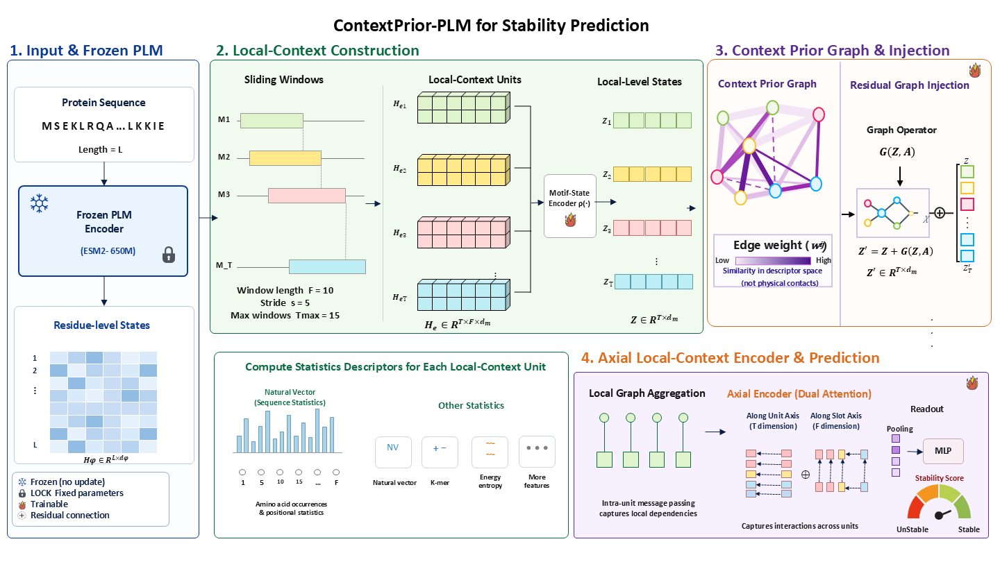

<div align="center">

# ContextPrior-PLM

### Local-context graph adaptation of protein language models for stability prediction

[]()
[]()
[]()
[]()
[]()

**ContextPrior-PLM** is a frozen protein language model adapter for protein variant stability prediction.
It preserves ESM-2 residue states in overlapping local-context units and injects Natural Vector-guided graph information before sequence-level readout.

</div>

---

## Project overview

<p align="center">
  <a href="figs/overview.pdf">
    
  </a>
</p>

<p align="center">
  <b>Click the figure to open the full project overview PDF.</b>
</p>

---

## What is included?

This repository is a compact public code release for training **ContextPrior-PLM** on protein stability prediction and selected BioMap tasks.

It includes:

* ContextPrior-PLM model implementation;
* dataset loaders for SaProtHub stability and  BioMap tasks;
* training and evaluation scripts;
* configuration files for the main experiments;

 
---

## Why ContextPrior-PLM?

Protein engineering often requires selecting a small number of candidate variants for costly experimental validation. A useful stability predictor should therefore support both accurate stability-score regression and stable-variant prioritization.

Many frozen PLM-based predictors compress residue-level representations into sequence-level summaries before prediction. This early aggregation can weaken local sequence-context signals that are relevant to protein stability.

ContextPrior-PLM introduces an intermediate local-context representation before sequence-level readout.

---

## Method at a glance

ContextPrior-PLM combines two components:

 
1. **Overlapping local-context units**
   Projected residue states are grouped into overlapping windows, preserving local PLM-derived context before global aggregation.

2. **Natural Vector-guided context prior graph**
   Local contexts are connected using alignment-free sequence-statistical similarity derived from Natural Vector descriptors. The graph does not rely on structural coordinates or annotated motifs.

The graph-derived information is injected into the local-context field before sequence-level prediction.

---

## Main results

On the SaProtHub protein stability benchmark, ContextPrior-PLM with frozen ESM-2 650M achieved:

| Model | Spearman | Pearson | RMSE | MAE | P@1000 | EF@1000 | AUPRC |
| ----- | -------- | ------- | ---- | --- | ------ | ------- | ----- |
| ContextPrior-PLM | 0.9259±0.0004 | 0.9354±0.0012 | 0.4198±0.0018 | 0.2958±0.0046 | 0.719±0.014 | 14.3848±0.2830 | 0.5080±0.0026 |
| ESM-2 650M + matched MLP | 0.7939±0.0026 | 0.8044±0.0009 | 0.6905±0.0010 | 0.5177±0.0027 | 0.425±0.025 | 8.4989±0.4911 | 0.2553±0.0081 |
| ESM-2 650M + MLP | 0.7818±0.0068 | 0.7951±0.0030 | 0.7114±0.0086 | 0.5356±0.0145 | 0.395±0.011 | 7.8990±0.2107 | 0.2418±0.0085 |
| ESM-2 3B + MLP | 0.7480±0.0029 | 0.7590±0.0006 | 0.7649±0.0112 | 0.5833±0.0163 | 0.370±0.009 | 7.4057±0.1890 | 0.2117±0.0051 |
| ProtT5-XL + MLP | 0.8426±0.0037 | 0.8592±0.0010 | 0.5947±0.0023 | 0.4390±0.0046 | 0.520±0.011 | 10.3920±0.2230 | 0.3286±0.0039 |
| Ankh-large + MLP | 0.5967±0.0053 | 0.6418±0.0071 | 0.8918±0.0064 | 0.6936±0.0040 | 0.266±0.004 | 5.3126±0.0757 | 0.1363±0.0035 |
| NV + MLP | 0.6833±0.0003 | 0.7200±0.0003 | 0.8065±0.0006 | 0.6125±0.0013 | 0.325±0.018 | 6.5058±0.3523 | 0.1795±0.0078 |
| EEV + MLP | 0.6362±0.0022 | 0.6849±0.0009 | 0.8467±0.0012 | 0.6413±0.0024 | 0.326±0.010 | 6.5258±0.2003 | 0.1678±0.0014 |

Values are mean ± sample standard deviation across seeds 41, 42 and 43. Precision@1000, EF@1000 and AUPRC are computed for the true top 5% stable variants.
 

---

## Installation

Clone the repository:

```bash
git clone https://github.com/karlieswift/ContextPrior-PLM.git ContextPriorPLM
cd ContextPriorPLM
```


---

## Data preparation

### SaProtHub stability

For SaProtHub stability, either place a local Hugging Face cache at:

```text
data/stability/saprothub_meta_stability
```

 

### BioMap tasks

BioMap tasks are loaded through the dataset loader (either place a local Hugging Face cache):

```text
src/contextPrior/data/biomap.py
```
For SaProtHub stability and biomap, either download the prepared data bundle from Zenodo:

```text
https://sandbox.zenodo.org/records/514784
```
---

## Run the main stability experiment

The public default uses frozen ESM-2 650M with the ContextPrior local-context and Natural Vector-guided graph adapter.

 

Equivalent direct Python command:

```bash
python scripts/run_stability_finetune.py \
  --config configs/base.yaml \
  --config configs/stability_experiments/stability_main.yaml \
  --config configs/data/saprothub_meta_stability_official_csv.yaml \
  --config configs/methods/ours.yaml \
  --config configs/backbones/esm2_650m.yaml \
  --config configs/scales/xlarge_650m.yaml \
  --config configs/contextprior/default_graph.yaml \
  --config configs/contextprior/stability_dense_f10_s5_t15.yaml \
  --config configs/train_modes/frozen.yaml \
  --config configs/runtime/seed42.yaml
```
 
---

## Run selected BioMap tasks

 

Equivalent direct Python command:

```bash
python scripts/run_finetune.py \
  --config configs/base.yaml \
  --config configs/experiments/biomap_selected_stable_variant.yaml \
  --config configs/methods/ours.yaml \
  --config configs/backbones/esm2_650m.yaml \
  --config configs/scales/xlarge_650m.yaml \
  --config configs/contextprior/default_graph.yaml \
  --config configs/train_modes/frozen.yaml \
  --config configs/runtime/seed42.yaml
```

 
 
---

 
 

 

## Data and code availability

Data and code used in this study are available at:

```text
https://github.com/karlieswift/ContextPrior-PLM
```

An archived version of the repository and accompanying data is available from Zenodo:

```text
https://sandbox.zenodo.org/records/514784
```

For the final publication version, the sandbox Zenodo record should be replaced by a formal Zenodo DOI.

---

## Citation

If you use ContextPrior-PLM in your research, please cite:

```bibtex
@article{wang2026contextpriorplm,
  title   = {Local-context graph adaptation of protein language models for stability prediction},
  author  = {Wang, Hao and Hu, Guoqing and Zhao, Xin and Yau, Stephen S.-T.},
  year    = {2026}
}
```


---

<div align="center">

**ContextPrior-PLM: preserving local PLM-derived context for stability prediction and stable-variant prioritization.**

</div>
